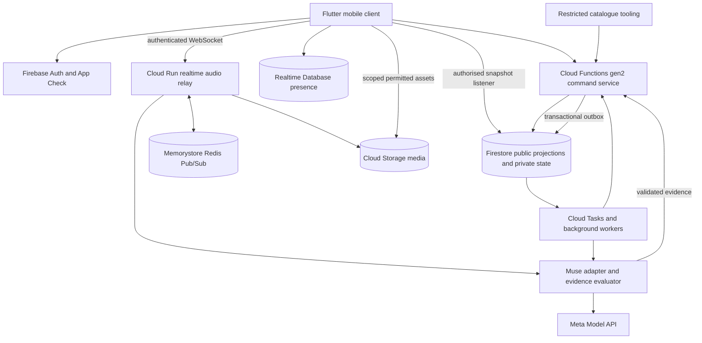

# Architecture and integration boundaries

Status: proposed implementation baseline. Version: 1.0. Date: 2026-10-27. Product contract: [PRD.md](PRD.md). Canonical machine-readable schemas: `packages/contracts/schema/`. Human-readable interface guide: [contracts/](contracts/).

## 1. Architecture decisions

1. Flutter owns presentation, microphone capture, authorised playback and local display state. It never decides a competitive score.
2. Firestore holds durable room/match state and score history. A trusted server command service is its gameplay writer.
3. Realtime Database provides advisory presence and disconnect signals. It is not the source of match results or microphone authority.
4. Cloud Run relays live PCM and proxies Muse sessions. Firestore and RTDB never carry live audio frames.
5. Redis Pub/Sub distributes transient room audio/control across Cloud Run instances. Correctness must not depend on session affinity.
6. Cloud Functions gen2 handles short commands and background work. Cloud Tasks schedules deadline checks, retries and outbox dispatch; delivery timing is not the authoritative deadline.
7. Storage holds permitted clue assets and temporary answer recordings. Private answer manifests and temporary media have distinct access policies.
8. Muse output is evidence, passed through a schema validator and deterministic evaluator. It does not write Firestore or invoke arbitrary tools.
9. All ten rounds implement one round-engine interface. New formats compose common attempt, scoring, media and role services.
10. Provider requests, asset downloads and other nontransactional effects never run inside a retryable Firestore transaction.

## 2. Deployment view



The diagram shows logical boundaries; the Muse adapter may run in the same Cloud Run deployment as the relay for the pilot, but it retains a distinct internal interface and concurrency budget. No mobile caller receives the provider API key. General analytics and logs receive redacted event records, not the arrows' raw media payloads.

## 3. Repository structure and task ownership

```text
apps/mobile/lib/features/<component>/<slice>.dart
apps/mobile/test/<component>/{unit,adverse,integration}/<slice>_test.dart
packages/contracts/schema/                     Canonical machine-readable schemas
packages/contracts/                            Generated protocol representations
services/game-api/src/features/<component>/<slice>.ts
services/game-api/test/<component>/{unit,adverse,integration}/<slice>.test.ts
services/game-api/src/entrypoints/              Deployment-role composition
tools/ops/<component>/<slice>.py
tools/ops/tests/<component>/                   Operational-tool verification
infra/firebase/                                Rules, indexes and emulator config
infra/cloud/                                   Deployment and service identities
docs/contracts/                                Human-readable protocol guide
docs/design/                                   Component designs
docs/rounds/                                   Round designs
backlog/                                       Task manifest and task cards
orchestration/                                 Ready batch and completion evidence
```

The task manifest is authoritative for each worker's exact files, including task-specific TypeScript/Dart registration descriptors. Bootstrap tooling generates the shared registries from those descriptors. Workers do not edit shared imports, route tables or indexes. Pure game rules, Muse adapters, relay logic and command/worker modules all use the single `services/game-api` codebase; components are not separate microservices.

Role-separated entrypoints compose the same tested modules for Cloud Functions commands/background handlers and Cloud Run relay/AI deployments. Deployment identity and permissions remain separated even when source modules share a package. Internal content/editor/operator UI is implemented as protected Flutter routes in `apps/mobile` for the MVP; a separate admin app is deferred. Its routes do not grant backend authority by themselves.

A worker that needs to change a shared schema, lockfile or generated registry must request the owner/integrator task rather than editing it opportunistically. The canonical contract is `packages/contracts/schema`; `docs/contracts` explains that contract. Generated consumers must stay aligned to the same schema version.

## 4. Durable data and access separation

The final path spelling and schema fields are defined by the contracts. The following logical records must exist:

| Record | Required content | Reader/writer policy |
|---|---|---|
| Profile | UID, display name, avatar, locale, consent version | User reads/limited updates own profile; server enforces safe public projection |
| Room | Host UID, membership, teams, ready versions, settings, status | Members read safe projection; commands mutate |
| Invite lookup | Opaque room mapping, expiry, attempts/capacity policy | Resolver service only; no client enumeration |
| Match snapshot | Phase, current round/attempt, eligible actor, timestamps, public scores, sequence | Members read; command service writes |
| Private match manifest | Clue order, target song IDs, accepted sections, future assets and rule version | Backend only |
| Performer secret | R07 target and permitted cue data for one current actor | Only current performer through scoped server response; short lived |
| Attempt | Actor, round/rule/catalogue versions, media reference, lifecycle, verdict reference | Safe projection to members; evidence private |
| Judgment evidence | Transcript, candidate IDs, route version, quality measurements, reason codes | Restricted backend/operator; player gets safe explanation |
| Score entry | Deterministic delta, attempt ID, rule version, correction linkage | Members can read relevant final ledger; server append only |
| Command receipt | Caller, idempotency key, request digest, result, retention | Server only; caller receives its own result |
| Outbox event | Effect ID, payload digest, pending/leased/delivered state | Worker only |
| Catalogue revision | Songs, variants, cue boundaries, rights and publication state | Public discovery subset separate from private answer material |
| Deletion request | User scope, state, object inventories, completion evidence | Requesting user sees status; worker operates |

Do not put a secret field next to public fields in a document clients may read. Firestore security rules authorize document access; a UI hiding a field is not an access boundary. Keep answer-bearing titles, future clue IDs and transcripts out of public snapshots until the reveal policy permits them. Storage object names should be opaque; a signed asset URL must not contain a title that answers the clue.

Storage has separate prefixes or buckets for published clue media, transient answer media and editor source assets. Upload permissions bind UID, room, attempt, content type, duration and byte cap. Only the server can publish a recording as usable evidence. TTL fields support cleanup, but a scheduled deletion worker and audit reconciliation enforce the promised retention deadline; expiry is not assumed to delete synchronously.

## 5. Command processing and exactly-once effects

Every mutating command has an authenticated actor, a client-generated idempotency key, a command type, a bounded payload and the expected room/match version. The server derives UID from verified authentication, never from an untrusted payload field.

Processing sequence:

1. Verify Firebase ID token, App Check where enforced, payload schema, request size and rate limit. Read configuration snapshot for this operation.
2. Hash the canonical request body. Begin transaction.
3. Read the command receipt. If already completed with the same digest, return its recorded result. If the same key carries a different digest, reject the conflict.
4. Read authoritative membership, match phase/version, actor eligibility and relevant attempt/ledger records. Reject stale or prohibited actions with stable reason codes.
5. Compute deterministic state changes. Write the state, monotonic sequence, receipt and any outbox effects together.
6. Commit. Only after commit, return the receipt result and dispatch effects through the outbox.
7. Workers claim an effect with a lease and idempotent effect ID. External calls may repeat; receiving handlers must deduplicate results. A worker records terminal delivery state or a bounded retry schedule.

For finalising an attempt, one transaction writes its terminal verdict and its uniquely keyed score entry. A retried AI callback cannot produce a second entry. A result tied to an older attempt generation, cancelled role, different media digest or later match phase is ignored and logged. Default scored play gives each team two assigned attempts per round; the final team round contribution is clamped to [−10, 40], including penalties, steals and corrections. A party correction requires both captains' approvals of the same proposal, appends a linked compensating entry, and marks the result unranked. A host cannot approve on behalf of the opposing captain or rewrite original evidence.

Firestore retries transaction callbacks under contention. That is why provider calls, random content selection without a stored seed, notifications, audio delivery and mutable global state are excluded. Content selection uses a stored deterministic seed plus an immutable catalogue revision. [Firestore transaction documentation](https://firebase.google.com/docs/firestore/manage-data/transactions) supports the atomic/retry model used here.

## 6. State machines

### Room lifecycle

`OPEN → PREPARING → IN_MATCH → RESULTS → OPEN` for rematch; `OPEN/PREPARING/RESULTS → EXPIRED` for inactivity; explicit user departure can produce `CLOSED` when empty. Host migration changes management authority without resetting match state. A start command uses a version barrier so a concurrent roster/settings change invalidates its preconditions.

### Match and attempt lifecycle

The semantic phases are prepare, briefing, cue, answering, judging, optional steal, reveal, round-complete and match-complete. Paused/recovering is a bounded server-controlled overlay with a stored resume phase and reason. Do not model pause as a client-only boolean.

An attempt progresses through reserved, capturing/submitting, sealed, judging and one terminal state. A cancellation remains terminal. A sealed recording's digest and duration are immutable. A retry creates a new linked attempt rather than replacing the old attempt's evidence. Exact enum spellings and allowed transitions belong in the shared contracts.

All transitions have an actor/event, precondition, resulting version, deadline ownership and expected outbox effects. Each round supplies its permitted actions to the common engine; it cannot skip authentication or score ledger checks.

### Deadline ownership

Cloud Tasks requests a check for `(matchId, phase, generation, deadline)`. The handler compares the current generation and the server's current time. A delayed old task is a no-op. An early task reschedules. The handler advances only when the current state still owns that deadline. Live commands also call `advanceIfExpired` before acting, so a delayed scheduled delivery cannot extend the legal answer window. Client countdown is a presentation aid.

The same pattern handles room expiry, upload expiry, judging timeout and reconnection grace. No process must remain alive sleeping until a deadline. Cloud Tasks is retryable delivery, not an exact subsecond clock. See [Firebase task functions](https://firebase.google.com/docs/functions/task-functions).

Reconnect grace is 30 seconds and can be granted only once per interrupted turn. The stored turn generation and grace-used marker prevent repeated disconnects from extending it. Judging targets 4 seconds after capture ends and reaches a neutral uncertain fallback by the 8-second hard maximum; late evidence cannot revive the closed judgment.

### Optional party buzzer

Assigned turns are the scored default. Party buzzer mode stores the first eligible claim's opening time, a cutoff 100 ms later, admitted contenders and rotating team priority. Eligible claims committed inside that window join the contender set; late/replayed claims cannot move the cutoff. A resolver selects among the admitted teams using the stored priority and writes one winner transactionally. If the handler restarts, resolution uses the same persisted window and priority. Client timestamps do not determine admission, and winning is not simply the first successful claim transaction. Cloud Tasks may provide a delayed recovery check but is not relied upon for a precise 100 ms wake-up; resolution after the cutoff never admits additional late contenders.

## 7. Live media path

### Capture and relay

The baseline capture format is signed 16-bit little-endian mono PCM at 24 kHz, with small paced frames. The app's native/plugin adapter is responsible for actual device sample-rate conversion and handling audio route changes. At this format, one publisher emits approximately 48,000 bytes per second before transport overhead. The relay validates framing, byte rate, session binding and capture duration. It never forwards arbitrary unbounded client payloads.

The client connects to the app's relay with Firebase identity, an App Check assertion where supported, and a short-lived app-issued media session ticket. The ticket binds room, match, attempt, actor, direction, generation and expiry. This ticket is not a Meta token. On each floor/phase change, the relay updates or invalidates the permission. A connection that was once a member cannot retain indefinite media access after removal.

Only one scored publisher is active at a time. The room floor policy determines who can listen. R07's target is private to the performer, while permitted participants hear the hum and only the designated teammate/captain can answer. Cue playback and capture are coordinated so the clue is not inadvertently re-recorded as the player's response. Headphone guidance and local audio ducking help; automatic evidence must account for residual leakage.

### Multiple Cloud Run instances

Cloud Run WebSocket connections may land on different instances; affinity is best effort. Each relay publishes authorised audio to a room/attempt-specific Redis channel and fans out subscribed packets to its local authorised listeners. A listener may have no connection to the publisher's instance. Redis channel names use opaque IDs. Per-attempt sequence numbers are part of the app's relay envelope; strip that envelope before sending raw frames to Meta.

Redis Pub/Sub is transient. Lost frames are not replayed as if live; clients mark degraded playback and use the recovery policy. Durable match events remain in Firestore. Redis failure stops live audio, revokes or suspends the floor, and initiates a bounded recovery/void policy. It must not create a disconnected local sub-match. The [Cloud Run WebSocket guide](https://docs.cloud.google.com/run/docs/triggering/websockets) explains request timeouts, reconnects and cross-instance synchronization.

### Upstream ASR and final evidence

Only the publisher's server-side session opens a Muse transcription stream, preventing a per-listener multiplication of inference cost. Each attempt has a separate push-to-talk ASR session. The proxy handles the provider's handshake, paced audio, explicit end-of-stream, final response and bounded close. A recording-upload fallback accepts the same canonical audio in a supported WAV container when live ASR is unavailable.

ASR partials are optional private UI feedback. They cannot award points and should not leak answers to the opposing team before reveal. The server records a final transcript or failure code, then creates candidate evidence. Late transcripts are associated with the sealed attempt version and cannot alter a subsequent turn.

## 8. Round engine and catalogue interface

Each round module implements preparation, safe clue projection, private role data, eligibility checks, evidence requirements, deterministic evaluation inputs, reveal projection and compatibility validation. The common engine owns membership, transactions, attempts, deadlines, score limits, uncertainty, steals and audit events.

Catalogue records distinguish `canonicalSongId` from a recording/version ID. Duplicate rules normally use canonical song identity; phrase correctness uses the selected version and accepted alternatives. A round manifest fixes its catalogue, scoring, prompt and model-route versions at match start. Disabling unsafe content can force a current clue to be replaced or voided; it must not change the expected answer behind an already accepted submission.

Before starting, the selector checks pack eligibility, sufficient distinct questions per round, permitted audience/region, available assets and rule compatibility. Free-choice rounds are limited to the enabled pack. Out-of-pack answers receive a clear unsupported result with the casual-room review option, not a fabricated catalogue match.

## 9. AI evidence boundary

The AI service receives only the minimum needed evidence: attempt ID, sealed media reference or transcript, bounded candidate IDs, allowed phrase/section references, language hints and a versioned prompt. It returns a schema-constrained evidence object. The evaluator validates IDs, verifies phrase relationships, applies round rules and determines accepted/rejected/uncertain.

Provider self-reported confidence is not assumed available. Application quality measures can include audio completeness, transcript emptiness, lexical alignment margin, agreement across independent evidence and held-out calibration. They must be named for what they measure. A model's verbal certainty does not increase a score.

Muse Spark 1.3 handles text/visual reasoning. The documented audio caveat routes eligible audio-only fallback to Spark 1.2 after validation. Muse Voice Transcribe does not provide speech synthesis; the host uses prerecorded lines or device TTS. Muse Wonder/Image are offline optional features. Detailed model request shapes and release conditions belong to the AI component design.

## 10. Security and operational boundaries

- Firebase Auth identifies players; App Check is an additional app-attestation signal, not a replacement for authorisation.
- Direct client gameplay writes are denied. Admin SDK paths must perform their own membership and role checks because they bypass client security rules.
- Functions/relay/workers use distinct least-privilege service identities. Only the Muse adapter identity reads the provider secret.
- Cloud Run's public client ingress validates application credentials; internal worker endpoints require service authentication as well as payload validation.
- Join attempts, commands, media sessions and model calls have separate limits. A single user cannot spend an unbounded inference budget by opening rooms.
- Store no API keys in a public repository, app resources, client remote configuration, error messages or analytics.
- Treat prompts, transcripts and model outputs as untrusted. Catalogue answers are data, not instructions to the orchestrator or application.
- Signed asset access is scoped and expires; do not use permanent public download tokens for private answer recordings.
- Redacted logs carry trace, room, attempt, model route and reason codes; access to raw evidence is separately audited.

## 11. Observability, capacity and cost

Measure command latency, active rooms, live publishers, dropped audio frames, relay buffer size, ASR finalisation latency, model errors, uncertain outcomes, score corrections, deadline lateness and deletion lag. Cost counters separate processed ASR seconds, reasoning input/output tokens, image jobs, Firestore operations, Redis capacity, relay network egress and stored-media duration.

Start the pilot with an explicit small room cap and provider concurrency budget. Scale tests must include different Cloud Run instances and one forced relay restart. Do not extrapolate from a single localhost room. The worker's acceptance artifact records device models, network profile, app/server revisions and catalogue/model versions.

Circuit breakers prevent cascading retries. Each route has a timeout, maximum attempts, bounded queue and fallback outcome. A provider outage produces a neutral uncertain outcome; a private party may then use the auditable both-captain correction policy, which marks the result unranked. It never silently awards every answer or permits unilateral host scoring. Cached host text and prerecorded instructions keep the presentation usable without a model call for every screen.

## 12. Integration sequence

1. Freeze contract versions, fixtures and package ownership.
2. Establish emulator-backed guest identity, room create/join and one authoritative round with deterministic fake judgment.
3. Add live audio across two physical devices, then a four-device room across relay instances.
4. Add the real Muse adapter under a feature flag and replay the held-out singing corpus.
5. Integrate all ten round modules against the same round engine; test R07 privacy/compatibility separately.
6. Exercise reconnect, duplicate commands, provider failure, stale task delivery and score correction.
7. Complete content, privacy, operational and signing gates before production distribution.

Five ready tasks may be dispatched together only if their prerequisites are merged and their exclusive write paths do not intersect. Parallel branches are not integration evidence. At one five-task pickup every 30 minutes, 240 daily starts is a theoretical ceiling, not a delivery forecast. First-day priority marks integration order and does not assert that the entire production MVP fits that capacity. The release artifacts in [RELEASE_GATES.md](RELEASE_GATES.md) are the completion criterion.
