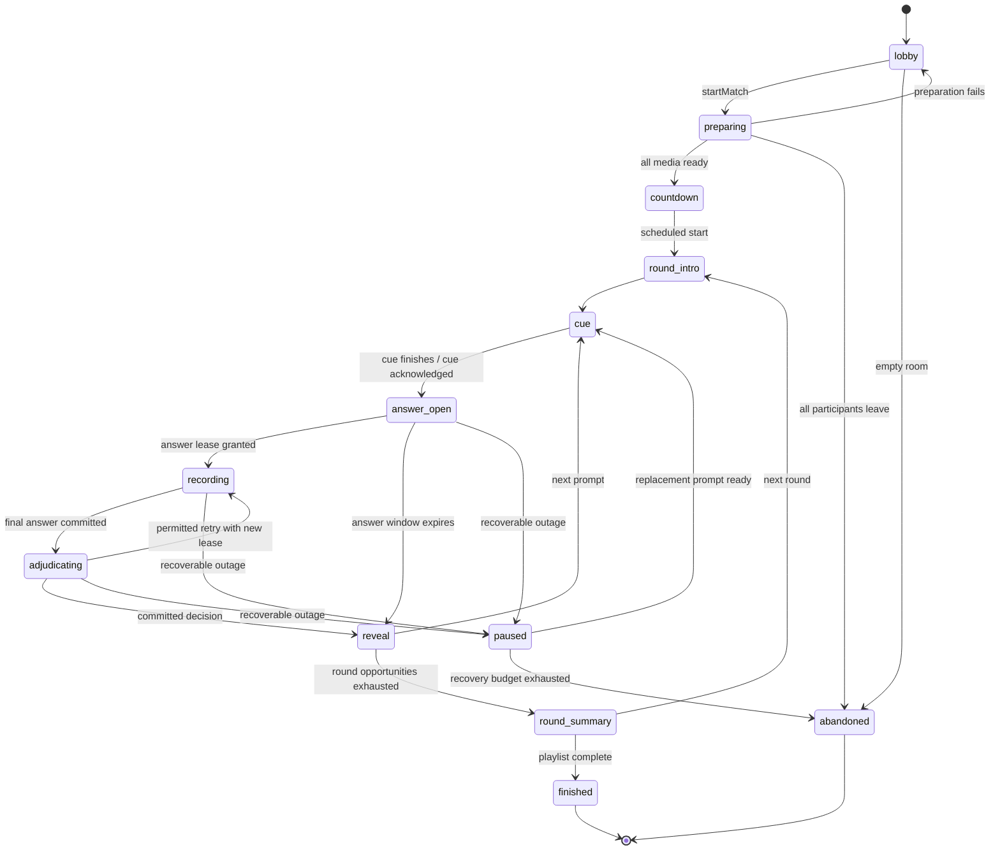
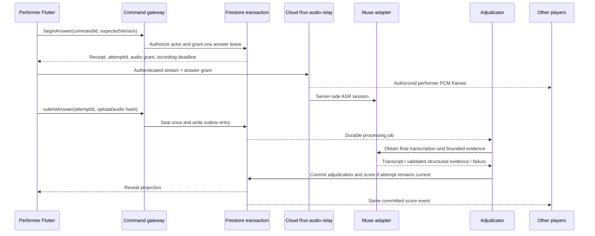

# Multiplayer flows and authoritative match protocol

Status: implementation specification. Owner: multiplayer integration lane. Revision: 2026-10-27. Targets below are acceptance targets, not measured performance.

## Scope and invariants

The mobile MVP supports private rooms with two teams: 1v1 or 2v2, at most four participants and no spectators. A standard match selects six eligible round formats; a 2v2 marathon selects all ten. Round 7 is disabled in 1v1 because it requires a teammate; the MVP has no prerecorded-hum replacement. A 1v1 custom match may select up to nine compatible formats. The ten-round marathon is available only in 2v2. Room creation never silently changes the advertised playlist.

Every scored state transition is server-authorized. Firestore holds durable match state and an append-only event ledger; clients observe authorized projections. Realtime Database reports presence, not match authority. Cloud Run carries short audio streams and Redis pub/sub distributes authorized audio across instances. Firebase Storage stores controlled media objects and answer recordings; neither database carries PCM frames. All four phones may connect to different Cloud Run instances.

Required invariants:

1. At most one active performer and one primary answer lease exist per prompt. A steal uses a new lease after the primary closes.
2. A command ID causes at most one logical mutation, score event, and logical inference job. External provider delivery can repeat after an ambiguous network failure; record actual provider usage and do not promise exactly-once external billing.
3. Prompt answers, future cue choices, and private hum cards never appear in a room-readable document, log, filename, push payload, or client bundle.
4. Only a committed adjudication produces a score event. Partial transcripts and host prose cannot modify scores.
5. Every participant sees monotonically increasing snapshot versions and event sequence numbers. Older data cannot overwrite a newer screen.
6. An infrastructure failure produces a retry, replacement prompt, or explicit pause; it never becomes an incorrect-answer penalty.
7. The winning result is based on committed score events, including correction events; a disconnected host cannot decide the result locally.

## Screens and transitions

| Screen | Required content and actions | Exit condition |
|---|---|---|
| Welcome | Guest sign-in, consent summary, language, microphone explanation | Authenticated player profile exists |
| Home | Create room, join by code, practice, recent match summary | Create or join succeeds |
| Room setup | 1v1/2v2, standard/marathon, era pack, party/scored rules | Valid settings and content coverage |
| Lobby | Team seats, player readiness, mic check, copy invite, round list | Correct population and all ready |
| Loading | Per-player asset preparation status, retry, leave | All required players acknowledge readiness |
| Match | Round task, team score, performer, authoritative countdown, cue and response controls | Server phase transition |
| Adjudication | Processing state and bounded wait; no editable answer | Result, retry, replacement, or pause |
| Reveal | Correct song/section, evidence explanation, score delta, dispute controls | Reveal interval expires |
| Round summary | Round delta and cumulative score | Next round or final result |
| Result | Winner/tie, contributions, rematch vote, leave | Rematch accepted or room closes |
| Reconnecting | Last confirmed phase, disabled score-affecting controls, retry/leave | Fresh authorized snapshot arrives |

Creation returns a random room ID and a separately rate-limited human join code. Invite URLs use Android App Links and iOS Universal Links with a hosted fallback page and manual code. A bare deep link is not authorization. Resolve the code server-side; reveal minimal room information until membership is admitted. Expired/full/started rooms show distinct errors. For the MVP, joining after match preparation begins is disallowed; existing members may reconnect.

## Lobby, permissions, and start

The host chooses settings and moves players between unoccupied seats. Players may request a move, mark themselves ready, or leave. A settings or roster change clears readiness for everyone. The server prevents a user or device session from occupying two seats. Each UID has one active room membership and one active game session for scoring purposes. Guest auth is permitted, but the user must accept audio processing before becoming ready for a singing playlist.

Start validates membership, team population, mic capability, content rights/availability, the selected round mix, and AI service health. The server freezes a `rulesVersion`, `catalogueVersion`, playlist, team roster, and deterministic random seed in private match state. Public state exposes only the round order. Commands that affect these values are rejected after preparation starts.

The host is a party control role, not the game server. If the host leaves the lobby, ownership moves to the earliest-joined remaining eligible member. During play, host loss never stops authoritative timers; a replacement host receives only pause/rematch/party-dispute privileges.

## Match state machine



`paused` stores the prior phase, reason, remaining recovery budget, and replacement policy. Resume never reopens an already-revealed answer. `finished` and `abandoned` are immutable terminal states except for a separate result-correction audit workflow. A rematch creates a new match ID and starts in the lobby with a new seed.

| Phase | Entry action | Exit trigger and guard |
|---|---|---|
| `preparing` | Produce sanitized manifests; issue short-lived asset grants | All required players prepared before 30-second preparation budget |
| `countdown` | Publish start time at least three seconds ahead | Server deadline and current phase token still match |
| `round_intro` | Publish one concise rule card and performer policy | Five-second rule interval or unanimous ready |
| `cue` | Publish current cue projection only | Clip end plus configured readiness margin; no answer title yet |
| `answer_open` | Set absolute server deadline and eligible actor/team | Valid begin/buzz command, or timeout |
| `recording` | Grant signed answer lease, route permitted audio | Explicit submit, max duration, transport failure, or silence rejection |
| `adjudicating` | Seal audio hash, persist job, enqueue outbox work | Target p95 final result within 4 seconds after capture ends; at 8 seconds choose neutral fallback; stale results ignored |
| `reveal` | Reveal accepted result, score delta, brief explanation | Four-second interval, longer if dispute active |
| `round_summary` | Publish cumulative committed result | Three-second interval or final round |

Round documents define answer windows. Default singing allows at most 20 seconds of recording after the lease starts; beginning must occur before the answer-open deadline. The server requires incoming non-silent audio within a two-second start grace, using deterministic energy/VAD checks with calibrated thresholds. This is a timing guard, not a claim that Muse detects singing. Begin actions that send no meaningful audio do not reserve the microphone indefinitely.

An uncertainty retry creates a new linked attempt ID and lease; it never overwrites sealed evidence. Transport recovery of the same interrupted recording retains its original attempt ID and cannot earn an additional award. These are different operations and must have separate commands/reason codes in the shared contract.

## Command and event contracts

The shared schema package is authoritative. This interface describes its intended semantics; implementers must consume its generated types rather than copying them into round modules.

```ts
type CommandEnvelope<T> = {
  schemaVersion: 1;
  commandId: string;       // UUID generated once; unchanged across retries
  matchId: string;
  expectedVersion: number;
  type: string;
  payload: T;
};
type CommandReceipt = {
  commandId: string;
  status: 'applied' | 'duplicate' | 'rejected';
  matchVersion: number;
  eventSeq?: number;
  errorCode?: string;
};
```

Firebase ID token and App Check proof accompany the transport; user identity never comes from `payload.uid`. Server-owned commands generated by a scheduler use service authentication and a stable deadline/job ID. Timestamps supplied by a client are diagnostic only.

Core command intents: `createRoom`, `joinRoom`, `leaveRoom`, `setRoomSettings`, `requestSeat`, `setReady`, `startMatch`, `ackCueReady`, `beginAnswer`, `buzz`, `submitAnswer`, `requestHint`, `requestPass`, `requestDispute`, `confirmOverride`, `requestPause`, `voteRematch`. `createRoom`/`joinRoom` precede a match and use the same idempotency/auth principles with room-scoped endpoints; do not invent a fake match ID. The shared contract owner defines their pre-match envelopes.

Server events include `room.member_joined`, `room.settings_changed`, `match.started`, `phase.changed`, `cue.ready`, `answer.granted`, `answer.sealed`, `adjudication.completed`, `score.applied`, `score.corrected`, `match.paused`, `match.finished`, and `match.abandoned`. Events carry `eventId`, `matchId`, `seq`, `version`, `occurredAt`, `type`, and a schema-validated payload. Projection builders publish participant-safe event bodies.

Optimistic version mismatches return `STALE_VERSION` with a fresh authorized snapshot. Clients regenerate a new command only if the user action still makes sense; transport retries preserve the original command ID. A stale `submitAnswer` may still be accepted if its server-issued lease and attempt ID are valid under the shared reducer's explicit exception; it must not create a second attempt.

## Answer pipeline



Provider calls, audio conversion, Redis operations, and task enqueueing never run inside a retryable Firestore transaction. A transaction creates an outbox record; a worker delivers it with an idempotency key and commits delivery state. A reconciler recovers unsent outbox records. External timeouts cannot roll back a committed match transition. A late inference completion cannot award points after replacement or abandonment. The judgment target is p95 within four seconds after capture ends, with a hard eight-second product deadline before neutral uncertain fallback. These are acceptance targets, not measured provider latency. Bounded retry attempts fit within that deadline or move to the explicit retry/replacement flow; they cannot hold a turn open indefinitely.

ASR partials are private by default while another team might steal. The current singer may see capture status; reveal transcripts only after the prompt closes. For Hum & Guess, only the hummer receives the private song card, and no inferred title is exposed to listeners during guessing.

## Audio, cue synchronization, and fallback

Clients prepare sanitized cues, then acknowledge readiness. The server publishes `cueStartAt`; devices estimate server offset from timestamped responses and start locally. This improves alignment but does not remove network latency. Cue playback finishes before the response microphone becomes available. Microphone capture and speaker routing handle headphones, Bluetooth changes, interruptions, and user mute explicitly.

The answer relay uses single-singer PCM at 24 kHz, mono signed 16-bit little-endian, with application sequence metadata outside the raw audio sent to Muse. Cross-instance distribution uses a room/attempt channel with membership checks and bounded buffers. A subscriber receives no previous performer's frames after a new lease. Slow consumers lose buffered frames and reconnect rather than exhausting server memory. At four participants this architecture must be load-tested before production capacity claims are made.

On stream loss, the client can upload its already captured short recording with the same attempt ID if the server lease permits recovery. Never resubmit as a new scored attempt. If audio cannot be recovered, allow one no-penalty replacement prompt. Muse availability does not control whether other players hear the performance.

## Fair turns, buzzers, and scoring

Equal-turn play is the MVP default: two assigned primary opportunities per team. Starting teams alternate, and 2v2 performers rotate. R02 and R09 may instead use an optional four-clue shared-buzzer policy displayed before start. Each normal primary opportunity has a maximum of 20 points. R02/R09/R10 split this into identification 10 plus singing 10; R07 awards 20 for the teammate's correct identification, and R08 awards 10 per correctly identified song without a singing bonus. Steals award at most 10. Round score is clamped to the range -10 to 40 per team after all deltas; there are no hidden speed bonuses. A hint reduces the available maximum by 5 once, floored at zero; it is not an extra negative penalty when the answer earns nothing. Rules and caps are displayed before play and frozen for the match.

Optional shared-buzzer rounds use four shared clues and retain the 40-point team cap. The first accepted server receipt opens a 100 ms contender window. Eligible receipts inside that window are resolved by a published rotating team priority, then participant seat order; later receipts lose. Priority alternates after each contested clue. Transaction/queue ordering and persisted server receipt times are authoritative. This is a contention policy, not perfect compensation for network latency. Equal-turn play remains the default, and there are no millisecond speed bonuses. The winner receives the complete response window after ownership is granted.

Collect contenders in prompt-scoped private state without advancing the public match version for every receipt. Each buzz names the current `promptId` and `phaseToken` and retains its command ID across retries. Recording the first contender must not make the second contender stale solely because a version changed. The resolver commits one winning lease and advances the match version once. Old-prompt, duplicate and late claims cannot reopen the prompt. The resolver may execute after the 100 ms cutoff but must use the persisted receipt cutoff; Cloud Tasks is not assumed to execute at millisecond precision.

Incorrect awarded buzzes cost 5 points only when adjudication is confidently wrong; a failed buzz transport costs nothing. A hint reduces the maximum earned result by 5 and cannot be charged twice through retries. One steal opportunity per opposing team per prompt is allowed only where the round document permits it. A steal's performer must also hold a server lease.

## Failure and recovery matrix

| Condition | Player experience | Authoritative handling |
|---|---|---|
| App backgrounds during cue | Reconnecting overlay; cue state restored on return | Mark presence away; do not trust local timer |
| Singer disconnects | Teammate sees recovery countdown | One 30-second reconnect grace per interrupted turn; recover sealed recording or replace once |
| Entire team absent | Pause message | Use the same one-time 30-second interrupted-turn grace, then apply the displayed incomplete/forfeit policy |
| Host disappears | Small host-change notification | Elect replacement; match server continues |
| Duplicate begin/submit | Existing status shown | Return original receipt and attempt; no new inference |
| Stale timer task | No visual change | Check phase token/version/deadline; ignore stale callback |
| Muse fails/abstains | Retry or human-review explanation | No wrong-answer penalty; at most one retry, then replacement or consensual party override |
| Cue missing/corrupt | “Replacing this clue” | Invalidate prompt; select equal-difficulty unused substitute |
| One player cannot prepare media | Loading retry | Preparation budget expires; return lobby without scoring |
| Backend outage | Paused/reconnect screen | Recover from durable state and outbox; abandon after configured 120-second budget |
| Unknown enum/schema | Update-required message | Reject incompatible command; no partial processing |

Each team has one formal review request per match. Private party overrides are proposed only after the explanation/reveal phase and after any steal closes; they require an explicit proposed result and confirmation from both teams' designated captains. In 1v1, both players confirm. The proposing captain's confirmation counts once, and the host cannot confirm for another team. Rejected/unanswered proposals use replacement or the existing verified result. An override adds a correction event referencing the original decision and marks the match unranked; it never edits the previous event in place.

## Security and data boundaries

Room projections contain public scores and current cues. Private server documents contain expected song/section IDs, canonical lyrics, random seed, future cues, model evidence, prompt templates, and adjudication internals. Participant-specific projections contain only that participant's hum card, grants, and receipts. Security rules reject cross-room reads and all direct client score writes; server handlers also authorize every action because Admin SDK bypasses rules.

Audio grants are short-lived, attempt-bound, single-performer, and revoked when the attempt closes. Storage rules restrict uploads to the granted path and enforce size/type; backend validation verifies the bytes, hash, duration, and ownership. Default raw-answer retention is the release policy defined in the privacy design, not an indefinite archive. Logs include IDs/timing/status, not audio, lyrics, tokens, or signed URLs. Invite codes are rate-limited and rotate on host request before a match starts.

## Proposed round plugin seam

```ts
interface RoundPlugin {
  readonly roundType: string;
  eligibility(ctx: EligibilityContext): EligibilityResult;
  prepare(ctx: PrivatePreparationContext): Promise<PrivateRoundPlan>;
  project(plan: PrivateRoundPlan, viewer: Viewer): PublicRoundCue;
  validateAttempt(attempt: SealedAttempt, evidence: AnswerEvidence): RoundDecision;
  nextOpportunity(state: RoundState): Opportunity | null;
}
```

Preparation may perform catalogue I/O outside a state transaction. Projection is deterministic and cannot include hidden answer data. `validateAttempt` is a pure decision over sealed evidence; the orchestration service owns provider calls and scores. Plugins cannot independently mutate global timers, membership, score totals, or grants. The parent contract document fixes concrete types and error enums before plugins are implemented.

## End-to-end acceptance

- Four real phones join by invite/code, prepare, finish six rounds, and display identical event sequences and totals.
- A two-phone match disables R07 and the ten-round marathon; no hidden prerecorded or AI teammate replacement is selected.
- Each of the ten round plugins completes one valid and one invalid attempt through the same adjudication seam.
- Two near-simultaneous buzzes produce exactly one winner under the optional contender-window policy; client clock manipulation cannot win a buzzer or extend recording.
- A singer loses Wi-Fi mid-answer, reconnects, and produces at most one score and one final inference job.
- An outbox worker and deadline task are each delivered twice; no duplicate score or cue advancement results. Repeated external provider delivery is correlated and visible in actual usage accounting.
- A player cannot read another participant's hum card or any future expected answer using a modified client.
- AI outage and corrupt media result in explicit recovery without unfair penalties.
- Host loss, member loss, app suspension, a stale snapshot, and a rematch all preserve the documented state invariants.
- Launch latency/voice-quality targets are measured on the supported Android/iOS device and network matrix before the release gate is approved.
